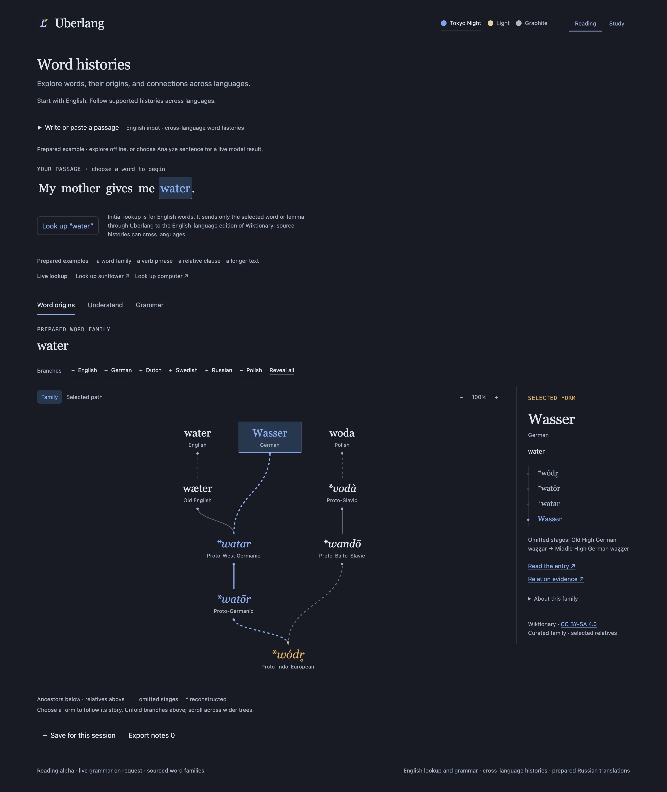
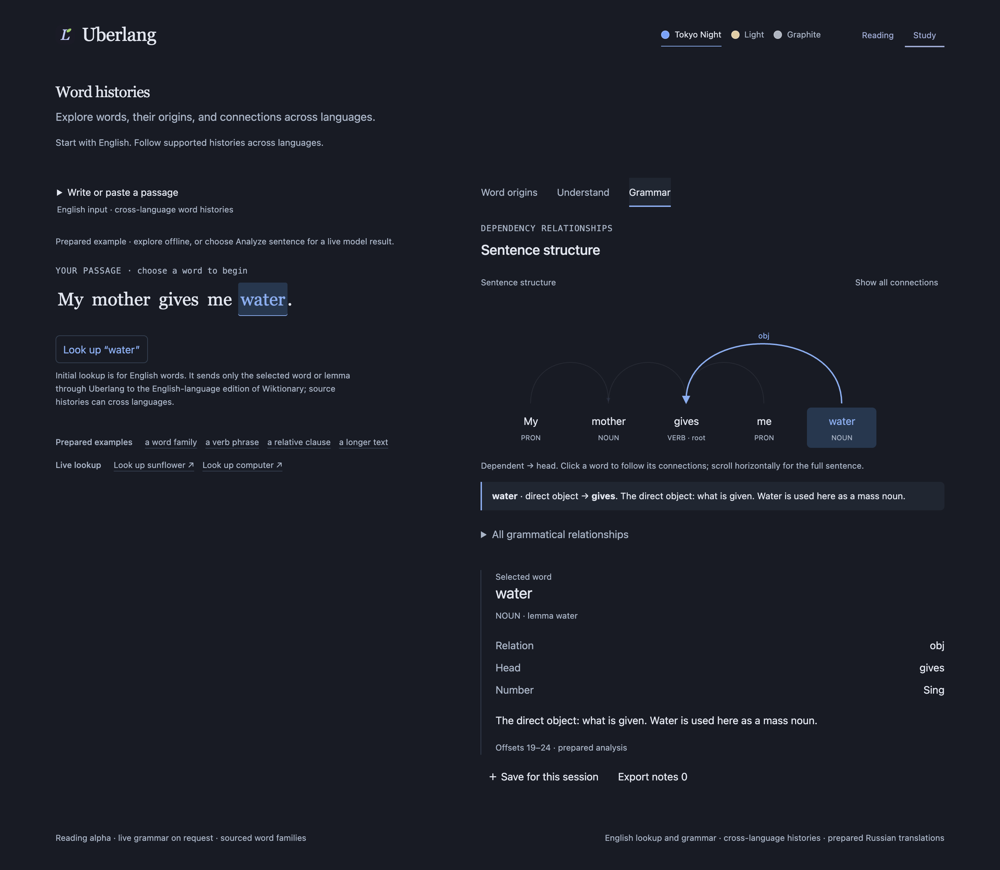
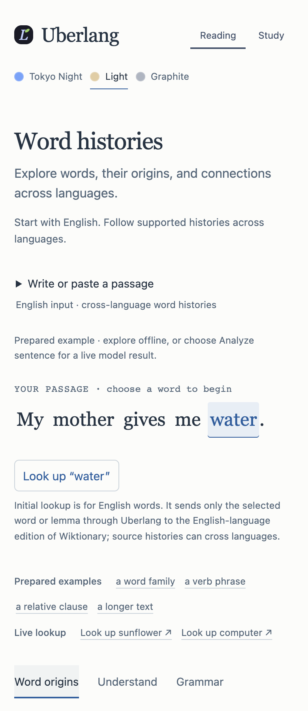

<div align="center">


# Uberlang

**Explore words, their origins, and connections across languages.**

A space for independent language learners and curious readers to follow sourced word histories.
Start with an English word or passage; explore supported forms across languages.
Built with TypeScript, React, D3, and Motion.

[](https://github.com/Godsdar/Uberlang/actions/workflows/ci.yml)
[](https://uberlang.vercel.app/)
[](LICENSE)

**[Open Night notebook](https://uberlang.vercel.app/)** ·
[Quick start](#quick-start) · [Product specification](docs/PRODUCT_SPEC.md)

</div>

> [!NOTE]
> Uberlang is an early personal project. Reading and Study share the same capabilities.
> Initial word lookup and sentence analysis are English; **Explore deeper** can follow
> supported forms in other languages through the English-language edition of Wiktionary.
> A prepared language branch is not proof of live coverage. The workspace offers **live English grammar analysis**
> alongside three prepared examples. It uses spaCy, a statistical model that can
> make mistakes. New sentences receive a grammar-based reading; an explicit word
> lookup retrieves dictionary senses and supported etymological sources from
> Wiktionary. Coverage is partial, and senses are not automatically disambiguated.

## A word’s family

Look up a new word to explore its documented sources, or choose the curated
`water` and `mother` families to explore relatives across languages. Live graphs
show supported explicit sources/components; they are not complete word families.
Distinct origins, source links and reconstructed forms remain visible.

Try **Look up sunflower** or **Look up computer**, select a form, then choose
**Explore deeper**. Each click reads one Wiktionary entry and unfolds its supported
sources. Separate etymologies require a choice; components and inflected forms
are labelled separately from ancestry. Expanded histories and their revision links
travel with exported notes. No paid API is required.

[](docs/assets/uberlang-reading-family-desktop-2026-10-18@2x.png)

*Reading · prepared water family, selected German form and cited evidence.*

## Language coverage

| Mode | Coverage |
|---|---|
| Initial word lookup and live sentence grammar | English in both Reading and Study |
| Live history continuation | Supported forms/language sections, including Spanish, French, Russian and Polish; available evidence and reachable nodes determine each path |
| Prepared word families | Curated water/mother branches across languages, including German, Dutch, Swedish and Russian; water also includes Polish |
| Translation | Prepared English → Russian examples |

English Wiktionary names the source edition, not an English-only collection of words.
There is no general non-English initial lookup or grammar selector in this notebook.
Source coverage varies; reconstructed forms and incomplete histories remain labeled.
[Detailed coverage and current marketing guidance](docs/MARKETING_POSITIONING.md).

## A sentence’s structure

Select a word to inspect its lemma, grammatical features, head, and dependency.
Explore an expression or a particular occurrence inside longer text, then save
its explanation and context as a study note.

[](docs/assets/uberlang-study-grammar-desktop-2026-10-18@2x.png)

*Study · prepared English grammar example with the selected word, its dependency and grammatical features.*

<details>
<summary>Mobile Reading — Light theme, 390 px</summary>

<p align="center">
<a href="docs/assets/uberlang-reading-mobile-2026-10-18@2x.png"></a>
</p>

</details>

All three images are **2×, lossless PNG** captures taken directly from the
[live notebook](https://uberlang.vercel.app/) on 18 October 2026. The built-in
prepared examples remain labeled in the interface. Open an image to inspect it
at full resolution.

## Notebook design refinement

The current source uses an open page, restrained serif headings and a plain tree
canvas. The passage comes before examples; language branches, selected paths,
source evidence and all three themes remain available. A keyboard skip link,
visible form focus and touch-sized controls support navigation.

Verified application release, 2026-10-18:
[`c935fc3`](https://github.com/Godsdar/Uberlang/commit/c935fc3c49e215d362d71daaa1c233c8c4f3065d)
at [uberlang.vercel.app](https://uberlang.vercel.app/). The
[production deployment](https://vercel.com/godsdar/lingua/7ZEdaQGZnxWzkjhXsfj6eDkUMcow)
is Ready and includes the Uberlang spelling and quieter section grouping.
[Design decision and validation scope](docs/decisions/ADR-021-notebook-visual-refinement.md).

Section headings and spacing group the notebook without repeated horizontal
dividers. Tree connections, active-control cues, input boundaries and keyboard
focus remain visible across all three themes and both layouts.

## What works today

| Feature | Night notebook |
|---|---|
| Analysis | Live English lemmas, features and dependencies; prepared examples available |
| Meaning | Grammar-based sentence reading and live dictionary sense alternatives |
| Etymology | Progressive sourced histories for new words; curated `water` and `mother` families |
| Translation | Prepared English → Russian examples |
| Notes | Session notes; downloadable Markdown, JSON, and HTML |
| Interface | Reading/Study layouts; Tokyo Night, Light, Graphite |

Night notebook is the only published web interface. The old standalone translator,
language overview and My roots screens have been retired. Existing saved roots
are kept in browser storage; **Download saved roots** appears when a previous
collection is present. This downloads an unchanged JSON backup; it does not
convert roots into session notes. Old `/concept/` links open the home page, and
`?q=` links prefill text without submitting it.

The concept demonstrates simple syntax, the present perfect progressive, and a
relative clause. Choose **Analyze sentence** to parse your own English sentence. Only that sentence
is sent to Uberlang; no third-party inference service is used. The separate lexical
lookup sends only the selected headword to Wiktionary. Dictionary senses are
alternatives, and a grammar-based reading cannot resolve intent, irony or ambiguity.
Unsupported histories remain explicitly unavailable.
Notes are cleared on reload; export first to keep them. JSON ranges use UTF-16
with an exclusive end index. [Workflow and provenance](docs/CONCEPT.md).

## Quick start

**Node.js 24+ and npm.** Prepared examples and frontend development require no API key.

```sh
git clone https://github.com/Godsdar/Uberlang.git
cd Uberlang
npm ci
npm run dev:web
```

Open Vite’s printed URL for Night notebook. Prepared examples work immediately.
For local live grammar, word lookup and history continuation, follow the
[runtime setup](docs/BACKEND_RUNBOOK.md#live-grammar-alpha-adr-013-2026-10-16):
Python 3.12 runs the private worker; `npm run dev:api` starts the notebook adapter
on `127.0.0.1:8788`. Configure `LINGUA_API_KEY` and `LINGUA_ENGINE_URL` server-side
as described there. Vite proxies `/api` to that adapter; `npm run dev:server`
serves the separate `/v1` API. The hosted demo is already configured.

| Command | Purpose |
|---|---|
| `npm test` | Domain, export, dictionary, and API resilience tests |
| `npm run typecheck` | Desktop, web, and API typechecking |
| `npm run dev:web` / `npm run build:web` | Web development / production output in `web/dist` |
| `npm run dev` / `npm run build` | Electron development / output in `out` |
| `npm run dev:api` | Notebook `/api/*` adapter on `127.0.0.1:8788`; requires runtime setup above |
| `npm run dev:server` | Separate Fastify `/v1` API on `127.0.0.1:8787` |
| `npm run build:server` / `npm run start:server` | Standalone API in `server-dist` / run it |
| `npm run build:gateway` | Bundle the public Node gateway in `server-dist/public-gateway.mjs` |
| `npm run smoke:server` | Verify the built API and graceful shutdown |
| `npm run preview` | Run the built desktop app |
| `npm run build:ext` | Chrome MV3 extension in `extension/dist` |
| `npm run dist:mac` / `npm run dist:win` / `npm run dist:linux` | Desktop installers in `release` |

Electron and extension commands maintain the earlier local prototypes for compatibility;
they are not the current product or published notebook releases. Their shared code
and separate on-device collections remain intact. Desktop/mobile notebook releases
are future work.

<details>
<summary>Docker and deployment</summary>

```sh
docker build --target web -t lingua-web .
docker run --rm -p 8080:80 lingua-web
docker build --target ci -t lingua-ci .
```

`vercel.json` tests and builds the web app, Node gateways and private Python worker.
The Vercel demo is published through the CLI. GitHub Pages remains an automatic
static mirror with tests and typechecking before publication; live endpoints run
only on Vercel or a configured local backend.
[Deployment instructions](docs/DEPLOYMENT.md).

</details>

## Architecture

```text
src/core/              Browser-compatible dictionary, translation, and tree logic
src/shared/            Shared types and IPC contracts
src/main/              Electron main process
src/preload/           contextBridge adapter
src/renderer/          Earlier Electron UI (not included in the web build)
web/                   Night notebook home page and web build
web/concept/           Notebook controller, typed explorers/domain, styles, old-URL redirect
src/data/              Shared curated reading examples and sourced families
server/                Node.js 24 + Fastify API, contracts and provider resilience
engine/                Pinned Python/spaCy grammar worker and model tests
api/                   Vercel public gateway and private model entrypoint
extension/             Chrome MV3 popup and context menu
docs/                  Specifications, design, architecture, and decisions
```

One shared core supports web, Chrome, and Electron. The reading workspace keeps input local until explicit analysis. Its typed React
graph explorers consume validated model output with exact token occurrences.
The editor and report controller are still JavaScript; gradual extraction continues.

## Backend foundation

The opt-in API uses **Node.js 24 LTS, TypeScript, and Fastify 5**. It exposes
versioned analysis/translation endpoints, OpenAPI, health checks, strict input
limits, bounded provider concurrency, cancellation, deadlines, and a circuit breaker.
Translation is disabled by default. Production and non-loopback listeners require
a service credential; never put that credential into frontend code.

```sh
npm run dev:server
# In another terminal:
curl http://127.0.0.1:8787/v1/capabilities
```

The public `/api/analysis` gateway calls a private Python worker running
**spaCy 3.8.7 + en_core_web_sm 3.8.0 (MIT)**. It accepts one English sentence
(up to 50 words / 500 UTF-16 units) and exposes no paid translation route.
The separate `/api/lexicon` route queries the fixed Wiktionary API through a
throttled adapter. Definitions and source graphs remain independent of grammar.
Prepared examples still work offline.
The gateway is stateless; there are no accounts or persistent server notes.
Vercel Hobby has usage caps and no availability guarantee. See
[the live-analysis decision](docs/decisions/ADR-013-live-grammar-alpha.md) and
[lexical evidence decision](docs/decisions/ADR-014-live-lexical-evidence.md).
The `/api/etymology` route continues a selected historical form on demand, with
the same request limits and a shared per-instance page cache. See the
[progressive history decision](docs/decisions/ADR-016-progressive-sourced-history.md).

[Architecture](docs/BACKEND_ARCHITECTURE.md) · [Runbook](docs/BACKEND_RUNBOOK.md) ·
[Backend decision](docs/decisions/ADR-012-node-backend.md)

## Data and privacy

The notebook keeps text local until an explicit analysis or word lookup. Selected
sentence context goes to the language engine; selected headwords and historical
forms go to English Wiktionary through the gateway. There are no accounts or
application telemetry. Saved-root backups download locally and never leave the
browser automatically.

Live dictionary data and historical concept data credit **English Wiktionary contributors, CC BY-SA 4.0**.
Entry links, relation evidence, and condensed paths are retained in reports.
An asterisk means an unattested reconstruction; similar spelling or meaning alone
does not prove historical kinship. [Data license](https://creativecommons.org/licenses/by-sa/4.0/).

## Roadmap and documentation

Next: linguistically review the statistical parser with pilot readers, expand
sourced families, and add durable local notes.
Branch disclosure, selected-lineage focus, dependency arcs, and reduced-motion-aware
transitions are now implemented in the concept.

- [Product specification](docs/PRODUCT_SPEC.md) and [architecture plan](docs/ARCHITECTURE_PLAN.md)
- [Concept workflow](docs/CONCEPT.md) and [deployment](docs/DEPLOYMENT.md)
- [Architecture decisions](docs/decisions/), [existing design](docs/DESIGN.md), and [graphics](docs/GRAPHICS.md)
- [Interaction design](docs/TREE_AND_ANALYSIS_DESIGN.md), [architecture review](docs/reviews/2026-10-13-architecture.md), and [engine evaluation](docs/ENGINE_EVALUATION.md)
- [Current marketing and language coverage](docs/MARKETING_POSITIONING.md); [archived launch plan](docs/LAUNCH_STRATEGY.md)
- [Design research: Night notebook and alternatives](docs/DESIGN_RESEARCH_2026-10-16.md)
- [Model implementation playbook](docs/MODEL_PLAYBOOK.md)
- [Contribution guide](CONTRIBUTING.md) and [agent rules](AGENTS.md)

## Architecture and long-term roadmap

The current API uses Node.js/TypeScript and Fastify with a private Python/spaCy
worker. See the [backend architecture](docs/BACKEND_ARCHITECTURE.md) and
[local/runtime setup](docs/BACKEND_RUNBOOK.md).

The [Rust backend roadmap](docs/RUST_BACKEND_ROADMAP.md) is a long-term plan,
not an implemented migration. It starts with measured bottlenecks, one bounded
prototype and API/UTF-16/source compatibility gates. Python/spaCy stays behind
its existing boundary initially; any replacement needs quality evidence and a
safe rollback. It does not add services, dependencies or new language modes.
