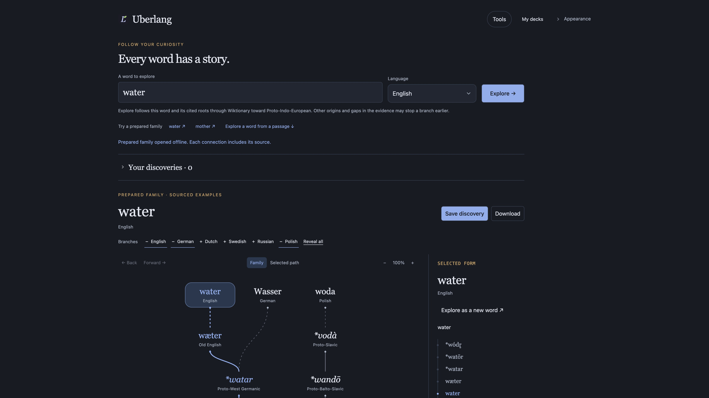
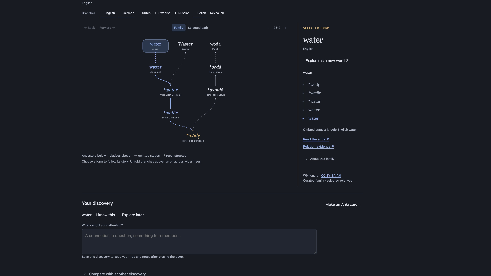

<div align="center">


# Uberlang

**Explore words, their origins, and connections across languages.**

A space for independent language learners and curious readers to follow sourced word histories.
Start with a word and its language; follow evidence and save a personal trail of discoveries.
Built with TypeScript, React, D3, and Motion.

[](https://github.com/Godsdar/Uberlang/actions/workflows/ci.yml)
[](https://uberlang.vercel.app/)
[](LICENSE)

**[Explore word histories](https://uberlang.vercel.app/)** ·
[Quick start](#quick-start) · [Product specification](docs/PRODUCT_SPEC.md)

</div>

> [!NOTE]
> Uberlang is an early personal project. Word histories use supported language
> sections of English Wiktionary; coverage is partial. Multiple etymologies stay
> separate, and a component or inflection is not presented as an ancestor.
> Grammar and dictionary meanings for passages remain English-only. Prepared
> families are labeled and work offline. No live translation or automatic sense
> selection is offered.

## Start with a word

Search or browse the grouped **Language** menu, then choose **Explore**. The word and its cited forms are looked up
sequentially toward **Proto-Indo-European (PIE)**. Separate etymologies pause for
your choice. Other origins, unsupported forms or missing evidence can end a
branch earlier; the app never invents a PIE connection. **Stop tracing** keeps
progress, **Continue tracing roots** resumes, and **View PIE root** reveals a
reached root. Select any form to inspect its evidence or explore it as a new word.
Back/Forward revisit selected forms without another request. Fold branches,
focus a path and zoom without shrinking the text into unreadability.

**Save discovery** keeps the loaded graph, selected form, branches, zoom, scroll,
notes and personal marks on this browser. Further changes to a saved discovery
autosave. **Your discoveries** reopens it without network requests. JSON download
and a previewed restore provide a portable backup; clearing browser data removes
local copies. Limits: 30 discoveries / 2 million UTF-16 units. Write errors are
visible; another tab's newer library is not silently overwritten.

Compare two saved explorations to find common **forms**, with separate source
links. This is a lead to research, not proof of a common ancestor. Language
interests star existing branches without inventing new ones.

**Read in context** keeps passages, English grammar and session notes nearby.
**My decks → Explore this word** prefills the same research workspace locally;
choose Explore to follow its cited roots; the imported passage is not sent. A discovery can become an Anki card
through the existing editable TXT export. The **Tools** menu remains available,
and **Appearance** holds the themes and reading layouts.

## Screenshots · 4K

[](docs/assets/2026-10-23/uberlang-research-4k.jpg)

*Start with a word, choose its language and follow its sourced history.*

[](docs/assets/2026-10-23/uberlang-tree-4k.jpg)

*Prepared water family: rounded selected form, related branches, PIE root and entry evidence.*

Direct browser captures of the published app on 23 October 2026, in Tokyo Night.
Both files are **3840 × 2160** pixels, captured at a 1920 × 1080 CSS viewport with
2× device scale. The tree detail uses 75% tree scale. These are real prepared
examples, labeled in the interface; they are not mockups or live lookup results.

## Language coverage

| Mode | Coverage |
|---|---|
| Research word lookup | Modern, historical and reconstructed languages listed in the searchable Language menu, including Spanish, French, Russian, Latin and PIE |
| Passage lookup and live sentence grammar | English |
| Live history continuation | Supported forms/language sections, including Spanish, French, Russian and Polish; available evidence and reachable nodes determine each path |
| Prepared word families | Curated water/mother branches across languages, including German, Dutch, Swedish and Russian; water also includes Polish |
| Translation | Prepared English → Russian examples |

English Wiktionary is the source edition; its entries cover many languages.
Research lookup uses the selected supported language. Coverage depends on cited
evidence, and each branch can stop before PIE. Passage grammar uses an installed
English model; selecting another passage language does not add a grammar model.
Reconstructed forms and incomplete histories remain labeled.
[Detailed coverage](docs/MARKETING_POSITIONING.md).

## Read in context

Open **Read in context** to work with a passage. Select a word or expression to
inspect its origins, or explicitly analyze an English sentence for lemmas,
grammatical features and dependencies. Prepared examples remain labeled.
Session notes and Anki drafts connect the passage back to the research journey.

## Save a context card for Anki

Choose **Anki…** beside the selected fragment or a saved session note. Review the
original source, edit the word/language/context/answer, and reveal preview,
deck/tags/optional sense label and sourced word history when needed. Export one
UTF-8 TXT for Anki Desktop 2.1.54+: map Front/Back/Tags, keep HTML off and select
**Ignore duplicates** before importing. A download or repeated-export warning
does not confirm membership in your Anki collection.

The TXT export was built directly on published main. Its scope includes no
unpublished declutter work, AnkiConnect connection, API-key entry or localhost/CSP
permission change. The broader desktop adapter exists in a separate development
branch and is verified with mocks only; real installed-release and HTTPS-origin
compatibility remain unverified. Anki's clients handle mobile synchronization;
Uberlang does not implement direct AnkiWeb sync or APKG export.

See [scope and verification](docs/ANKI_EXPORT_MVP.md).

## Explore an Anki deck in Uberlang

Choose **My decks → Import a deck** and select an `.apkg` or UTF-8 Notes in Plain
Text (`.txt`/`.tsv`). Legacy schema 11 packages and modern schema 18 / Zstandard
packages are read locally in a cancellable worker. No Anki installation or
connection is needed. Import is available in the published web app.

Map word/expression, optional example and answer for each note type, then set its
language. Filter by deck, tag or text; select notes and review the import counts.
Only 20 previews appear at a time. Every sanitized field, nested deck membership,
tag and source GUID is retained in a separate local browser library. Existing
identities are skipped by default; explicit updates replace the local copy.

Open one English example in the notebook, or expand **Explore word history** for
a supported language. Opening an example sends nothing. A history lookup sends
only the word and language after clicking Look up; sentence analysis still needs
its own explicit action. Mixed languages in one note type require separate
selections/imports. Grammar remains English-only.

Limits: 32 MiB file/SQLite, 5,000 archive entries, 10,000 notes; export without
media or split large decks. Media, card templates, formatting and review schedules
are omitted with warnings; cloze answers become plain text. Unknown formats and
unsafe/corrupt packages are rejected. No scheduling transfer or two-way sync.
Storage belongs to this browser and site origin, may be cleared by the browser,
and is not a backup: keep the original file.

See the [format/safety specification](docs/ANKI_IMPORT_MVP.md),
[architecture decision](docs/decisions/ADR-024-local-anki-import.md) and
[synthetic tests and browser QA](docs/reviews/2026-10-19-anki-import.md).

## What works today

| Feature | Night notebook |
|---|---|
| Analysis | Live English lemmas, features and dependencies; prepared examples available |
| Meaning | Grammar-based sentence reading and live dictionary sense alternatives |
| Etymology | Explicit research follows cited roots toward PIE; curated `water` and `mother` families |
| Translation | Prepared English → Russian examples |
| Notes | Saved discoveries with local autosave and JSON backup; session exports in Markdown, JSON and HTML |
| Interface | Research workspace, searchable language menu, contextual tools; Tokyo Night, Light, Graphite |

Night notebook is the only published web interface. The old standalone translator,
language overview and My roots screens have been retired. Existing saved roots
are kept in browser storage; **Download saved roots** appears when a previous
collection is present. This downloads an unchanged JSON backup; it does not
convert roots into session notes. Old `/concept/` links open the home page, and
`?q=` links prefill text without submitting it.

The concept demonstrates simple syntax, the present perfect progressive, and a
relative clause. The **New text · no prepared answers** examples only load text locally.
Choose **Analyze sentence** to compute grammar for your own English sentence.
The editor holds 6000 UTF-16 units, but each request sends only one selected sentence
(maximum 50 words / 500 UTF-16 units; some symbols count as two). Only that sentence
is sent to Uberlang; no third-party inference service is used. The separate lexical
lookup sends only the selected headword to Wiktionary. Dictionary senses are
alternatives, and a grammar-based reading cannot resolve intent, irony or ambiguity.
Unsupported histories remain explicitly unavailable.
Notes are cleared on reload; export first to keep them. JSON ranges use UTF-16
with an exclusive end index. [Workflow and provenance](docs/CONCEPT.md).

## Quick start

**Node.js 24+ and npm.** Prepared examples and frontend development require no API key.

```sh
git clone https://github.com/Godsdar/Uberlang.git
cd Uberlang
npm ci
npm run dev:web
```

Open Vite’s printed URL for Night notebook. Prepared examples work immediately.
For local live grammar, word lookup and history continuation, follow the
[runtime setup](docs/BACKEND_RUNBOOK.md#live-grammar-alpha-adr-013-2026-10-16):
Python 3.12 runs the private worker; `npm run dev:api` starts the notebook adapter
on `127.0.0.1:8788`. Configure `LINGUA_API_KEY` and `LINGUA_ENGINE_URL` server-side
as described there. Vite proxies `/api` to that adapter; `npm run dev:server`
serves the separate `/v1` API. The hosted demo is already configured.

| Command | Purpose |
|---|---|
| `npm test` | Domain, export, dictionary, and API resilience tests |
| `npm run typecheck` | Desktop, web, and API typechecking |
| `npm run dev:web` / `npm run build:web` | Web development / production output in `web/dist` |
| `npm run dev` / `npm run build` | Electron development / output in `out` |
| `npm run dev:api` | Notebook `/api/*` adapter on `127.0.0.1:8788`; requires runtime setup above |
| `npm run dev:server` | Separate Fastify `/v1` API on `127.0.0.1:8787` |
| `npm run build:server` / `npm run start:server` | Standalone API in `server-dist` / run it |
| `npm run build:gateway` | Bundle the public Node gateway in `server-dist/public-gateway.mjs` |
| `npm run smoke:server` | Verify the built API and graceful shutdown |
| `npm run preview` | Run the built desktop app |
| `npm run build:ext` | Chrome MV3 extension in `extension/dist` |
| `npm run dist:mac` / `npm run dist:win` / `npm run dist:linux` | Desktop installers in `release` |

Electron and extension commands maintain the earlier local prototypes for compatibility;
they are not the current product or published notebook releases. Their shared code
and separate on-device collections remain intact. Desktop/mobile notebook releases
are future work.

<details>
<summary>Docker and deployment</summary>

```sh
docker build --target web -t lingua-web .
docker run --rm -p 8080:80 lingua-web
docker build --target ci -t lingua-ci .
```

`vercel.json` builds the web app and Node gateways and packages the private Python
worker. The Vercel demo is published through the CLI; GitHub Pages is a static
mirror. CI runs independently, so deployment does not repeat its tests and
typechecking (ADR-026). Live endpoints run only on Vercel or a configured local backend.
[Deployment instructions](docs/DEPLOYMENT.md).

</details>

## Architecture

```text
src/core/              Browser-compatible dictionary, translation, and tree logic
src/shared/            Shared types and IPC contracts
src/main/              Electron main process
src/preload/           contextBridge adapter
src/renderer/          Earlier Electron UI (not included in the web build)
web/                   Night notebook home page and web build
web/concept/           Notebook controller, typed explorers/domain, styles, old-URL redirect
src/data/              Shared curated reading examples and sourced families
server/                Node.js 24 + Fastify API, contracts and provider resilience
engine/                Pinned Python/spaCy grammar worker and model tests
api/                   Vercel public gateway and private model entrypoint
extension/             Chrome MV3 popup and context menu
docs/                  Specifications, design, architecture, and decisions
```

One shared core supports web, Chrome, and Electron. The reading workspace keeps input local until explicit analysis. Its typed React
graph explorers consume validated model output with exact token occurrences.
The editor and report controller are still JavaScript; gradual extraction continues.

## Backend foundation

The opt-in API uses **Node.js 24 LTS, TypeScript, and Fastify 5**. It exposes
versioned analysis/translation endpoints, OpenAPI, health checks, strict input
limits, bounded provider concurrency, cancellation, deadlines, and a circuit breaker.
Translation is disabled by default. Production and non-loopback listeners require
a service credential; never put that credential into frontend code.

```sh
npm run dev:server
# In another terminal:
curl http://127.0.0.1:8787/v1/capabilities
```

The public `/api/analysis` gateway calls a private Python worker running
**spaCy 3.8.7 + en_core_web_sm 3.8.0 (MIT)**. It accepts one English sentence
(up to 50 words / 500 UTF-16 units) and exposes no paid translation route.
The separate `/api/lexicon` route queries the fixed Wiktionary API through a
throttled adapter. Definitions and source graphs remain independent of grammar.
Prepared examples still work offline.
The gateway is stateless; there are no accounts or persistent server notes.
Vercel Hobby has usage caps and no availability guarantee. See
[the live-analysis decision](docs/decisions/ADR-013-live-grammar-alpha.md) and
[lexical evidence decision](docs/decisions/ADR-014-live-lexical-evidence.md).
The `/api/etymology` route continues a selected historical form on demand, with
the same request limits and a shared per-instance page cache. See the
[progressive history decision](docs/decisions/ADR-016-progressive-sourced-history.md).

[Architecture](docs/BACKEND_ARCHITECTURE.md) · [Runbook](docs/BACKEND_RUNBOOK.md) ·
[Backend decision](docs/decisions/ADR-012-node-backend.md)

## Data and privacy

The notebook keeps text local until an explicit analysis or word lookup. Selected
sentence context goes to the language engine; selected headwords and historical
forms go to English Wiktionary through the gateway. There are no accounts or
application telemetry. Saved-root backups download locally and never leave the
browser automatically.

Live dictionary data and historical concept data credit **English Wiktionary contributors, CC BY-SA 4.0**.
Entry links, relation evidence, and condensed paths are retained in reports.
An asterisk means an unattested reconstruction; similar spelling or meaning alone
does not prove historical kinship. [Data license](https://creativecommons.org/licenses/by-sa/4.0/).

## Roadmap and documentation

Next: review source coverage with pilot readers, improve incomplete-history
guidance and expand sourced families. Discovery notes already persist locally;
passage session notes still need export before reloading.
Branch disclosure, selected-lineage focus, dependency arcs, and reduced-motion-aware
transitions are now implemented in the concept.

- [Arbitrary text analysis requirements, quality limits and multilingual stages](docs/specs/ARBITRARY_TEXT_ANALYSIS.md)
- [Product specification](docs/PRODUCT_SPEC.md) and [architecture plan](docs/ARCHITECTURE_PLAN.md)
- [Concept workflow](docs/CONCEPT.md) and [deployment](docs/DEPLOYMENT.md)
- [Architecture decisions](docs/decisions/), [existing design](docs/DESIGN.md), and [graphics](docs/GRAPHICS.md)
- [Interaction design](docs/TREE_AND_ANALYSIS_DESIGN.md), [architecture review](docs/reviews/2026-10-13-architecture.md), and [engine evaluation](docs/ENGINE_EVALUATION.md)
- [Current marketing and language coverage](docs/MARKETING_POSITIONING.md); [archived launch plan](docs/LAUNCH_STRATEGY.md)
- [Design research: Night notebook and alternatives](docs/DESIGN_RESEARCH_2026-10-16.md)
- [Model implementation playbook](docs/MODEL_PLAYBOOK.md)
- [Contribution guide](CONTRIBUTING.md) and [agent rules](AGENTS.md)

## Architecture and long-term roadmap

The current API uses Node.js/TypeScript and Fastify with a private Python/spaCy
worker. See the [backend architecture](docs/BACKEND_ARCHITECTURE.md) and
[local/runtime setup](docs/BACKEND_RUNBOOK.md).

The [Rust backend roadmap](docs/RUST_BACKEND_ROADMAP.md) is a long-term plan,
not an implemented migration. It starts with measured bottlenecks, one bounded
prototype and API/UTF-16/source compatibility gates. Python/spaCy stays behind
its existing boundary initially; any replacement needs quality evidence and a
safe rollback. It does not add services, dependencies or new language modes.
