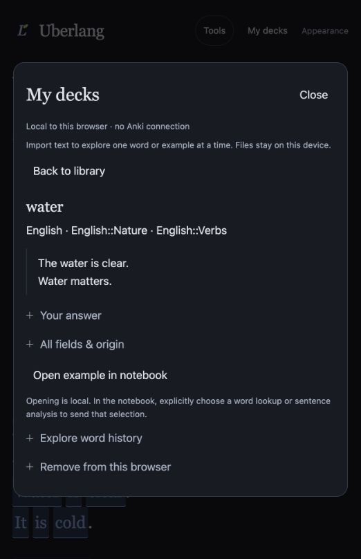

# Local Anki import: verification record

2026-10-19. Isolated branch `feat/anki-local-import`, based on published main
`87b10bd4fcefacba62c26b831a386f10a0727263`. The task-3 AnkiConnect/declutter checkout
was not modified or included. This record describes local validation, not a
production deployment. Parent coordination is required before push/publication.

## Automated checks

| Check | Result |
|---|---|
| `npm test` | 57 core/notebook tests + 34 server tests passed |
| `npm run typecheck` | Node, web and server passed |
| `npm run build:web` | Production bundle passed |
| `npm run build`, `build:ext`, `build:server`, `build:gateway` | All passed |
| `npm run smoke:server` | Startup/auth/prepared response/translation opt-in/shutdown and real socket cancellation passed |
| `scripts/check-anki-export-dom.mjs` | Three existing export regressions passed |
| `scripts/check-anki-import-dom.mjs` | Local opening, exact occurrence, editor focus, saved-note immutability and non-English guard passed |
| `git diff --check` | Passed |

The DOM scripts use external jsdom 30.1.3 via `NODE_PATH`; it was installed in a
temporary QA directory, not added to runtime dependencies. A reproducible setup:

```sh
npm install --prefix /tmp/uberlang-dom-qa --no-save jsdom@30.1.3
NODE_PATH=/tmp/uberlang-dom-qa/node_modules node scripts/check-anki-import-dom.mjs
NODE_PATH=/tmp/uberlang-dom-qa/node_modules node scripts/check-anki-export-dom.mjs
```

The 12 import tests use generated synthetic packages in
`scripts/anki-import-fixtures.mjs`: legacy/schema 11; modern/meta v3, Zstandard and
normalized schema 18 (including the real schema's `unicase` collation name);
reverse cards, original filtered decks, multiple types, nested decks/tags, cloze,
Unicode and hostile HTML. Tests cover malformed ZIP/CRC/path/expansion, unknown
versions with a compatibility placeholder, invalid SQLite tables/views/schema,
Zstandard allocation/truncation/concatenation, quoted multiline TXT/TSV, mapping,
deduplication, empty-word counts and retained extra fields. Worker cancellation,
timeout and size checks are tested; IndexedDB tests verify atomic rollback,
concurrent duplicate checks, update and removal.

## Browser QA

Used the actual production Vite preview on `127.0.0.1:5197` in Chromium, with
generated fixtures only. The production CSP successfully loaded the APKG worker
and same-origin SQL WASM. No personal Anki collection/settings were accessed.

- Imported a modern 25-note/two-type deck after mapping fields and explicit en/es
  languages; nested/original filtered memberships and tags remained visible.
  Pagination showed at most 20 notes. Reload retained all 25.
- Reimporting legacy data produced 0 new / 25 skipped with save disabled. Explicit
  update plus deck/tag selection changed one selected note, retaining 25 total.
- Imported a quoted multiline TSV note: review reported one new; save reported
  one new and the library contained 26. Focus moved to completion feedback.
- Opened an English example locally. Network observation showed zero requests;
  the editor received focus and source provenance, while old analysis was cleared.
  A Spanish note kept its language and had the English notebook action disabled.
- An explicit Spanish history lookup sent exactly
  `{"language":"es","term":"agua"}`. An intercepted synthetic response showed
  a history choice; selecting it rendered the existing sourced tree/attribution.
  The intercept was removed afterwards. This checks integration, not live source
  availability; the timeout path was also observed.
- A malformed `.apkg` showed “This is not a complete ZIP deck package.” and did
  not alter saved notes. No JavaScript console errors were observed.
- Tokyo Night, Light and Graphite layouts were checked at measured 1280 and
  390 CSS px: page width matched viewport width and dialog content did not
  overflow horizontally. A 320 px check prompted the small header-wrap fix.
  Escape returned focus to My decks; reduced-motion emulation was checked and
  reset. Native browser screenshots below retain only valid captures.



[390 px Tokyo Night view](../assets/anki-import/tokyo-390.png).

## Deployment and integration notes

SQL/WASM is loaded only for APKG. The production outputs include a 57.60 kB
worker, 21.50 kB APKG reader, 40.43 kB SQL loader and 684.90 kB WASM (335.62 kB
gzip). The main notebook JS is 485.32 kB (153.61 kB gzip). Only same-origin worker
and `wasm-unsafe-eval` CSP permissions were added; no remote host or general
`unsafe-eval` permission was added.

No server, shared analysis schema or English grammar contract changed. The new
`DeckNotebookEntry` callback in `concept.js` accepts English only and opens text
without analysis. Coordinate that small controller integration and README/ADR
numbering with the parallel sentence-analysis task. Do not merge the separate
AnkiConnect work implicitly. Keep the original import files: IndexedDB is local
origin-scoped storage, not cross-device synchronization or a backup.
